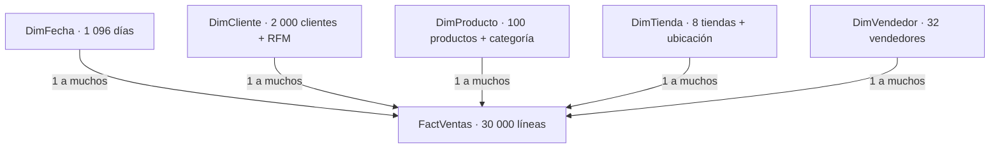

# Modelo estrella

Diagrama vectorial: [modelo_estrella.svg](modelo_estrella.svg). Fuente alternativa: modelo_estrella.dot (Graphviz opcional).

| Lado 1 | Clave dimensión | Clave FactVentas |
| --- | --- | --- |
| DimFecha | Fecha | Fecha |
| DimCliente | ClienteID | ClienteID |
| DimProducto | ProductoID | ProductoID |
| DimTienda | TiendaID | TiendaID |
| DimVendedor | VendedorID | VendedorID |

Todas las relaciones son activas, 1:* y unidireccionales desde dimensión hacia hechos. No crear relaciones entre DimTienda y DimVendedor ni entre región del cliente y región de tienda. Esto evita rutas ambiguas. DimFecha debe marcarse como tabla de fechas usando Fecha, única, sin huecos ni nulos.

Categoría se desnormaliza en DimProducto y ubicación en DimTienda. Categorias, Pedidos y DetalleVentas permanecen en origen/SQLite, pero no se cargan como tablas adicionales al modelo Power BI. PedidoID es dimensión degenerada en FactVentas. Canal también queda en la tabla de hechos.

Filtrar categoría selecciona productos y sus líneas. DISTINCTCOUNT(PedidoID) cuenta cada pedido visible una sola vez. Un pedido con productos de dos categorías aparece en ambas, por ello sumar el número de pedidos de categorías sobrecuenta el total. Un filtro de región usa ubicación de la tienda, no domicilio del cliente.

DimCliente contiene tanto todos los clientes como los atributos de segmentación. `Clientes unicos` cuenta compradores desde FactVentas. `Clientes segmento` cuenta el maestro y por diseño ignora filtros de tiempo y tienda. Esas dos medidas responden preguntas distintas.
